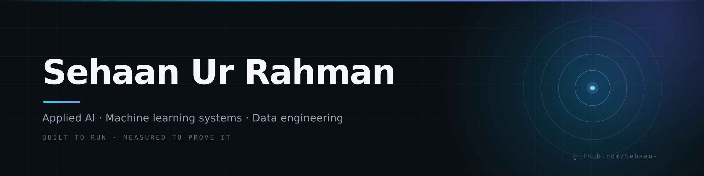

  <picture>
    <source media="(prefers-color-scheme: dark)" srcset="assets/banner-dark.png">
    <source media="(prefers-color-scheme: light)" srcset="assets/banner-light.png">
    
  </picture>

  <a href="https://www.linkedin.com/in/sehaan-rahman-967648296/">LinkedIn</a>
  &nbsp;·&nbsp;
  <a href="mailto:sehaanincollege@gmail.com">Email</a>
  &nbsp;·&nbsp;
  <a href="https://github.com/Sehaan-1?tab=repositories">Repositories</a>

---

Most of my work happens after the demo. The notebook that scores 0.94 still has to answer the same question twice without changing its mind, survive a CSV with a date from 1901 in it, and explain why it refused. That gap — between "it works on my machine" and "it works on a Tuesday" — is the part I find genuinely fun.

So I build the whole thing: the crawler, the model, the evaluation, the dashboard, the thing that notices when the pipeline silently stopped at 3 a.m. Mostly Python. Enough Go, Rust, C++ and C# to know where the real constraints live.

CS undergraduate at **VIT Bhopal**. Forty-odd public repos, most of them built to answer a question I couldn't put down.

---

## What I actually care about

**A metric without a denominator is a vibe.**  
Every project ships its own evaluation: retrieval recall, refusal accuracy, inter-annotator agreement, p50/p95 latency. If a number can't be reproduced from the repo, it doesn't go in the README.

**The happy path is a demo. The other paths are the product.**  
Idempotent writes, quarantine rows instead of crashed batches, bounded queues, graceful shutdown, and a test that deliberately kills the process mid-write.

**Write the reasoning down, or you'll relitigate it in six months.**  
ADRs, datasheets, annotation guidelines — mostly notes to future me, who will have forgotten everything and will be very confident anyway.

**Boring where it counts, clever where it pays.**  
A deterministic pipeline that always does the same thing beats a fast one that sometimes doesn't.

---

## Toolbox

**Languages**  
Python · TypeScript · SQL · Go · Rust · C++20 · C# · Java · Kotlin · R · JavaScript · Dart

**Machine learning**  
PyTorch · scikit-learn · XGBoost · SHAP · Hugging Face Transformers · FAISS · BM25 hybrid retrieval · YOLOv8 · ByteTrack · CLIP · OpenCV · Thompson sampling with drift detection · off-policy evaluation

**Data & evaluation**  
pandas · NumPy · DuckDB · dbt · Airflow · medallion architecture · Cohen / Fleiss / Krippendorff agreement (written from scratch) · annotation QA · data-quality scorecards · pytest, property-based tests, CI gates

**Web & product**  
FastAPI · Pydantic v2 · SQLAlchemy 2.0 · Node.js · Express · Spring Boot · React 19 · Next.js · Vite · Tailwind CSS · Three.js · Leaflet · D3 · TanStack Query · WebSockets · Jetpack Compose · Flutter · PostgreSQL · SQLite (WAL) · Redis · MySQL · Drizzle ORM · Flyway

**Infrastructure & observability**  
Docker & Compose · GitHub Actions · Prometheus · Grafana · nginx · Caddy · Cloudflare · Vercel · AWS (S3, Lambda) · GCP · healthchecks and staged rollouts

**Systems programming**  
Lock-free ring buffers and atomics · memory arenas · FastCDC chunking · TLS 1.3 framing · Lua inside Redis · BLE/GATT and ESP32 firmware · dependency-free parsers, encoders and renderers in Rust

---

## Ask me about

- Why a hybrid retriever beats a good embedding model on legal text
- Writing Krippendorff's alpha from scratch, and why the easy version is wrong
- What a lock-free SPSC ring buffer actually buys you at 400k orders/sec
- Recovering a broken pipeline at 3 a.m. without waking anyone up
- Rendering a ray-traced image in Rust with zero dependencies, on purpose
- Why I think every AI project should ship its own failure taxonomy

---

## Selected work

The pinned repositories below are the best entry points — one per discipline, each with its numbers, tests and trade-offs written down. Start anywhere; they all explain themselves.

  If you got this far, we should probably talk. <a href="mailto:sehaanincollege@gmail.com">sehaanincollege@gmail.com</a>

